# Денисов Кирилл 2 Лабораторная №1

# Задание 1

## Задача 1

### Текст задачи

Реализовать функцию double fraction(double x), возвращающую дробную часть числа x (для 5,25 – 0,25).

Общее требование к заданию: решение оформить в виде функции; в функции main организовать вызов с дружественным интерфейсом; если исходные данные вводятся с клавиатуры, выполнить проверку ввода.

### Алгоритм решения

1\. Меню (функция Task1, пункт 1) запрашивает число функцией ReadDouble: строка с лишними символами, например «5,25», отклоняется, и запрос повторяется.

2\. Fraction приводит число к int64\_t через static\_cast: дробная часть отбрасывается (округление к нулю).

3\. Разность исходного числа и его целой части – это дробная часть. Знак сохраняется: для −3,5 получается −0,5.

4\. Тип int64\_t выбран вместо int, чтобы корректно обрабатывать числа, большие 2³¹.

**Листинг 1 – Функция Fraction**

```cpp
// Задача 1 Дробная часть
double Fraction(double number) {
    return number - static_cast<int64_t>(number);
}
```

### Тестирование

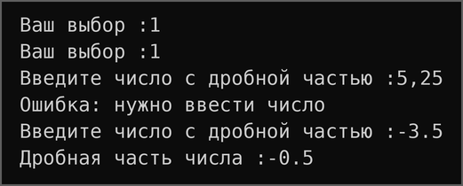

*Рисунок 1 – Задание 1, задача 1: работа программы*

## Задача 3

### Текст задачи

Реализовать функцию int charToNum(char x), преобразующую символ-цифру «0»…«9» в соответствующее число.

Общее требование к заданию: решение оформить в виде функции; в функции main организовать вызов с дружественным интерфейсом; если исходные данные вводятся с клавиатуры, выполнить проверку ввода.

### Алгоритм решения

1\. Меню (функция Task1, пункт 2) запрашивает символ функцией ReadCharToNum, которая принимает ровно один символ от «0» до «9» и иначе повторяет запрос.

2\. Коды цифр в таблице символов идут подряд: код «0» равен 48, код «9» – 57.

3\. Разность кода символа и кода «0» (symbol - '0') равна значению цифры.

**Листинг 2 – Функция CharToNum**

```cpp
// Задача 3 Букву в число
int CharToNum(char symbol) {
    return symbol - '0';
}
```

### Тестирование

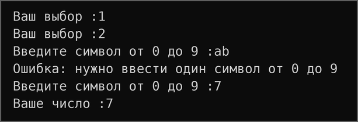

*Рисунок 2 – Задание 1, задача 3: работа программы*

## Задача 5

### Текст задачи

Реализовать функцию bool is2Digits(int x), возвращающую true, если число двузначное (32 – true, 516 – false).

Общее требование к заданию: решение оформить в виде функции; в функции main организовать вызов с дружественным интерфейсом; если исходные данные вводятся с клавиатуры, выполнить проверку ввода.

### Алгоритм решения

1\. Меню (функция Task1, пункт 3) запрашивает целое число функцией ReadInt.

2\. Число двузначное, если оно лежит в диапазоне от 10 до 99. Отрицательные числа, например −45, двузначными не считаются.

3\. Результат проверки возвращается конструкцией if/else, а BoolText переводит значение bool в текст для вывода.

**Листинг 3 – Функция Is2Digits**

```cpp
// Задача 5 Двузначное
bool Is2Digits(int number) {
    if (10 <= number && number <= 99) {
        return true;
    } else {
        return false;
    }
}
```

### Тестирование

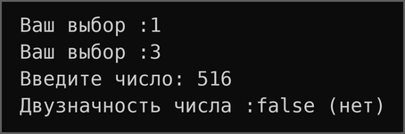

*Рисунок 3 – Задание 1, задача 5: работа программы*

## Задача 7

### Текст задачи

Реализовать функцию bool isInRange(int a, int b, int num), возвращающую true, если num входит в диапазон между a и b включительно; какая из границ больше, заранее неизвестно.

Общее требование к заданию: решение оформить в виде функции; в функции main организовать вызов с дружественным интерфейсом; если исходные данные вводятся с клавиатуры, выполнить проверку ввода.

### Алгоритм решения

1\. Меню (функция Task1, пункт 4) запрашивает две границы и число функцией ReadInt.

2\. Так как порядок границ неизвестен, проверяются оба случая: limit\_one \<= number \<= limit\_two или limit\_one \>= number \>= limit\_two.

3\. Нестрогие сравнения включают границы в диапазон. Например, для границ 5 и 1 число 3 входит в диапазон.

**Листинг 4 – Функция IsInRange**

```cpp
// Задача 7 Диапазон
bool IsInRange(int limit_one, int limit_two, int number) {
    if ((limit_one <= number && number <= limit_two) ||
        (limit_one >= number && number >= limit_two)) {
        return true;
    } else {
        return false;
    }
}
```

### Тестирование

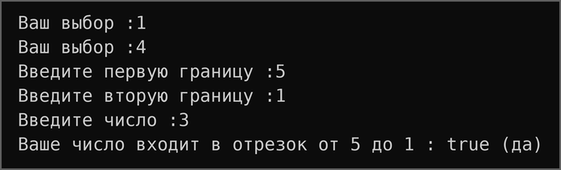

*Рисунок 4 – Задание 1, задача 7: работа программы*

## Задача 9

### Текст задачи

Реализовать функцию bool isEqual(int a, int b, int c), возвращающую true, если все три числа равны.

Общее требование к заданию: решение оформить в виде функции; в функции main организовать вызов с дружественным интерфейсом; если исходные данные вводятся с клавиатуры, выполнить проверку ввода.

### Алгоритм решения

1\. Меню (функция Task1, пункт 5) запрашивает три целых числа.

2\. Равенство транзитивно, поэтому достаточно двух сравнений: number\_one == number\_two и number\_two == number\_three, объединённых оператором &&.

**Листинг 5 – Функция IsEqual**

```cpp
// Задача 9 Равенство
bool IsEqual(int number_one, int number_two, int number_three) {
    if (number_one == number_two && number_two == number_three) {
        return true;
    } else {
        return false;
    }
}
```

### Тестирование

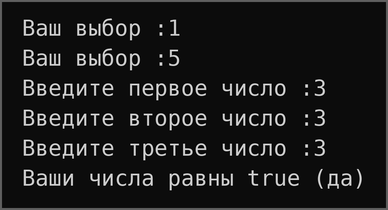

*Рисунок 5 – Задание 1, задача 9: работа программы*

*Таблица 1 – Результаты автотестов, задание 1*

| **Входные данные** | **Ожидается** | **Получено** | **Итог** |
| ------------------ | ------------- | ------------ | -------- |
| Fraction(5.25)     | 0.25          | 0.25         | пройден  |
| Fraction(-3.5)     | \-0.5         | \-0.5        | пройден  |
| Fraction(7.0)      | 0             | 0            | пройден  |
| CharToNum('3')     | 3             | 3            | пройден  |
| CharToNum('0')     | 0             | 0            | пройден  |
| CharToNum('9')     | 9             | 9            | пройден  |
| Is2Digits(32)      | true          | true         | пройден  |
| Is2Digits(516)     | false         | false        | пройден  |
| Is2Digits(-45)     | false         | false        | пройден  |
| Is2Digits(9)       | false         | false        | пройден  |
| IsInRange(5,1,3)   | true          | true         | пройден  |
| IsInRange(2,15,33) | false         | false        | пройден  |
| IsInRange(2,15,15) | true          | true         | пройден  |
| IsEqual(3,3,3)     | true          | true         | пройден  |
| IsEqual(2,15,2)    | false         | false        | пройден  |
| IsEqual(-1,-1,-1)  | true          | true         | пройден  |

# Задание 2

## Задача 1

### Текст задачи

Реализовать функцию int abs(int x), возвращающую модуль числа x.

Общее требование к заданию: решение оформить в виде функции; в функции main организовать вызов с дружественным интерфейсом; если исходные данные вводятся с клавиатуры, выполнить проверку ввода.

### Алгоритм решения

1\. Меню (функция Task2, пункт 1) запрашивает целое число.

2\. Если число неотрицательное, функция возвращает его само, иначе – с противоположным знаком.

3\. Имя AbsNum выбрано, чтобы не путать функцию со стандартной std::abs. Эта функция также используется в задаче 3 задания 4.

**Листинг 6 – Функция AbsNum**

```cpp
// Задача 1 Модуль числа
int AbsNum(int number) {
    if (number >= 0) {
        return number;
    } else {
        return -number;
    }
}
```

### Тестирование

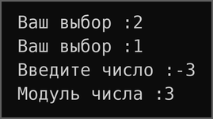

*Рисунок 6 – Задание 2, задача 1: работа программы*

## Задача 3

### Текст задачи

Реализовать функцию bool is35(int x), возвращающую true, если число делится на 3 или на 5, но не на оба числа одновременно.

Общее требование к заданию: решение оформить в виде функции; в функции main организовать вызов с дружественным интерфейсом; если исходные данные вводятся с клавиатуры, выполнить проверку ввода.

### Алгоритм решения

1\. Меню (функция Task2, пункт 2) запрашивает целое число.

2\. Результаты проверки остатков от деления (%) сохраняются в логические переменные by3 и by5.

3\. Число подходит, если оно делится ровно на одно из чисел, то есть значения переменных различны: by3 \!= by5. Например, 9 делится только на 3 (true), а 15 – на оба числа (false).

**Листинг 7 – Функция Is35**

```cpp
// Задача 3 Тридцать пять
bool Is35(int number) {
    bool by3 = (number % 3 == 0);
    bool by5 = (number % 5 == 0);
    if (by3 != by5) {
        return true;
    } else {
        return false;
    }
}
```

### Тестирование

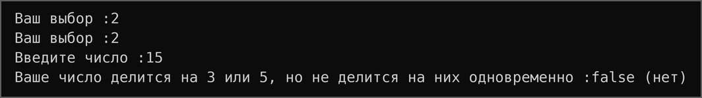

*Рисунок 7 – Задание 2, задача 3: работа программы*

## Задача 5

### Текст задачи

Реализовать функцию int max3(int x, int y, int z), возвращающую максимальное из трёх чисел; идеальное решение содержит две инструкции if без вложенности.

Общее требование к заданию: решение оформить в виде функции; в функции main организовать вызов с дружественным интерфейсом; если исходные данные вводятся с клавиатуры, выполнить проверку ввода.

### Алгоритм решения

1\. Меню (функция Task2, пункт 3) запрашивает три целых числа.

2\. Переменная result инициализируется значением number\_one.

3\. Двумя последовательными if она заменяется на number\_two или number\_three, если они больше текущего максимума.

**Листинг 8 – Функция Max3**

```cpp
// Задача 5 Тройной максимум
int Max3(int number_one, int number_two, int number_three) {
    int result = number_one;
    if (number_two > result) {
        result = number_two;
    }
    if (number_three > result) {
        result = number_three;
    }
    return result;
}
```

### Тестирование

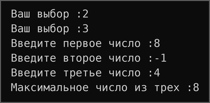

*Рисунок 8 – Задание 2, задача 5: работа программы*

## Задача 7

### Текст задачи

Реализовать функцию int sum2(int x, int y), возвращающую сумму x и y; если сумма попадает в диапазон от 10 до 19, вернуть 20.

Общее требование к заданию: решение оформить в виде функции; в функции main организовать вызов с дружественным интерфейсом; если исходные данные вводятся с клавиатуры, выполнить проверку ввода.

### Алгоритм решения

1\. Меню (функция Task2, пункт 4) запрашивает два целых числа.

2\. Сумма вычисляется один раз и сохраняется в переменную sum.

3\. Если сумма лежит в отрезке \[10; 19\], возвращается 20, иначе – сама сумма.

**Листинг 9 – Функция Sum2**

```cpp
// Задача 7 Двойная сумма
int Sum2(int number_one, int number_two) {
    int sum = number_one + number_two;
    if (sum >= 10 && sum <= 19) {
        return 20;
    }
    return sum;
}
```

### Тестирование

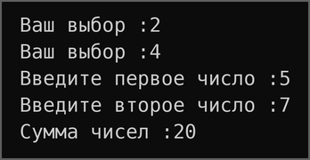

*Рисунок 9 – Задание 2, задача 7: работа программы*

## Задача 9

### Текст задачи

Реализовать функцию String day(int x), возвращающую название дня недели по его номеру (1 – понедельник, 7 – воскресенье); иначе вернуть «это не день недели». Использовать switch.

Общее требование к заданию: решение оформить в виде функции; в функции main организовать вызов с дружественным интерфейсом; если исходные данные вводятся с клавиатуры, выполнить проверку ввода.

### Алгоритм решения

1\. Меню (функция Task2, пункт 5) запрашивает номер дня недели.

2\. В инструкции switch каждому номеру от 1 до 7 соответствует своя ветвь case с возвратом названия дня.

3\. Все остальные значения обрабатывает ветвь default, которая возвращает «Это не день недели». Инструкция break не нужна, так как каждая ветвь завершается return.

**Листинг 10 – Функция Day**

```cpp
// Задача 9 День недели
std::string Day(int day_number) {
    switch (day_number) {
        case 1:
            return "Понедельник";
        case 2:
            return "Вторник";
        case 3:
            return "Среда";
        case 4:
            return "Четверг";
        case 5:
            return "Пятница";
        case 6:
            return "Суббота";
        case 7:
            return "Воскресенье";
        default:
            return "Это не день недели";
    }
}
```

### Тестирование

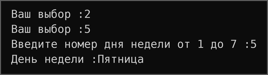

*Рисунок 10 – Задание 2, задача 9: работа программы*

*Таблица 2 – Результаты автотестов, задание 2*

| **Входные данные** | **Ожидается**      | **Получено**       | **Итог** |
| ------------------ | ------------------ | ------------------ | -------- |
| AbsNum(5)          | 5                  | 5                  | пройден  |
| AbsNum(-3)         | 3                  | 3                  | пройден  |
| AbsNum(0)          | 0                  | 0                  | пройден  |
| Is35(5)            | true               | true               | пройден  |
| Is35(8)            | false              | false              | пройден  |
| Is35(15)           | false              | false              | пройден  |
| Is35(9)            | true               | true               | пройден  |
| Max3(5,7,7)        | 7                  | 7                  | пройден  |
| Max3(8,-1,4)       | 8                  | 8                  | пройден  |
| Max3(-5,-2,-9)     | \-2                | \-2                | пройден  |
| Sum2(5,7)          | 20                 | 20                 | пройден  |
| Sum2(8,-1)         | 7                  | 7                  | пройден  |
| Sum2(10,9)         | 20                 | 20                 | пройден  |
| Sum2(10,10)        | 20                 | 20                 | пройден  |
| Sum2(15,6)         | 21                 | 21                 | пройден  |
| Day(5)             | Пятница            | Пятница            | пройден  |
| Day(1)             | Понедельник        | Понедельник        | пройден  |
| Day(7)             | Воскресенье        | Воскресенье        | пройден  |
| Day(18)            | Это не день недели | Это не день недели | пройден  |

# Задание 3

## Задача 1

### Текст задачи

Реализовать функцию String listNums(int x), возвращающую строку со всеми числами от 0 до x включительно (для 5 – «0 1 2 3 4 5»).

Общее требование к заданию: решение оформить в виде функции; в функции main организовать вызов с дружественным интерфейсом; если исходные данные вводятся с клавиатуры, выполнить проверку ввода.

### Алгоритм решения

1\. Меню (функция Task3, пункт 1) запрашивает N функцией ReadIntInRange: допустимы значения от 0 до 1000, иначе выводится ошибка и запрос повторяется.

2\. Цикл for добавляет к строке каждое число от 0 до limit и пробел после него.

3\. Завершающий пробел удаляется методом pop\_back(). Для отрицательного limit цикл не выполняется, и возвращается пустая строка.

**Листинг 11 – Функция ListNums**

```cpp
// Задача 1 Числа подряд
std::string ListNums(int limit) {
    std::string result = "";
    for (int i = 0; i <= limit; ++i) {
        result += std::to_string(i) + " ";
    }
    if (!result.empty()) {
        result.pop_back();
    }
    return result;
}
```

### Тестирование

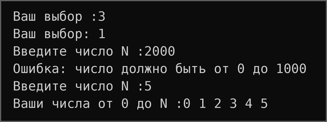

*Рисунок 11 – Задание 3, задача 1: работа программы*

## Задача 3

### Текст задачи

Реализовать функцию String chet(int x), возвращающую строку со всеми чётными числами от 0 до x включительно, не используя if.

Общее требование к заданию: решение оформить в виде функции; в функции main организовать вызов с дружественным интерфейсом; если исходные данные вводятся с клавиатуры, выполнить проверку ввода.

### Алгоритм решения

1\. Меню (функция Task3, пункт 2) запрашивает N функцией ReadIntInRange в отрезке от 0 до 1000, поэтому условие limit \>= 0 выполняется.

2\. Строка начинается с «0». Вместо проверки чётности цикл идёт с шагом 2, начиная с 2, поэтому в строку попадают только чётные числа.

3\. Инструкция if в функции не используется.

**Листинг 12 – Функция Chet**

```cpp
// Задача 3 Чётные числа
std::string Chet(int limit) {
    std::string result = "0";
    for (int i = 2; i <= limit; i += 2) {
        result += " " + std::to_string(i);
    }
    return result;
}
```

### Тестирование

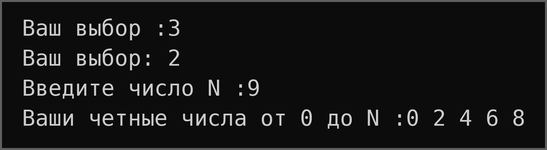

*Рисунок 12 – Задание 3, задача 3: работа программы*

## Задача 5

### Текст задачи

Реализовать функцию int numLen(long x), возвращающую количество знаков в числе x.

Общее требование к заданию: решение оформить в виде функции; в функции main организовать вызов с дружественным интерфейсом; если исходные данные вводятся с клавиатуры, выполнить проверку ввода.

### Алгоритм решения

1\. Меню (функция Task3, пункт 3) запрашивает целое число функцией ReadInt.

2\. Для нуля функция сразу возвращает 1.

3\. Иначе в цикле while число делится на 10, пока не станет нулём, а счётчик count считает количество делений. Для отрицательных чисел целочисленное деление тоже приводит к нулю, поэтому знак не учитывается.

4\. Вместо long используется int64\_t, так как размер long в Windows и Linux различается.

**Листинг 13 – Функция NumLen**

```cpp
// Задача 5 Длина числа
int NumLen(int64_t num) {
    if (num == 0) {
        return 1;
    } else {
        int count = 0;
        while (num != 0) {
            num = num / 10;
            ++count;
        }
        return count;
    }
}
```

### Тестирование

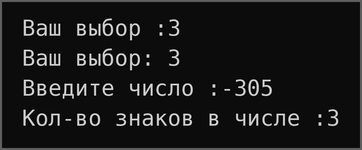

*Рисунок 13 – Задание 3, задача 5: работа программы*

## Задача 7

### Текст задачи

Реализовать функцию void square(int x), выводящую квадрат из символов «\*» размером x × x.

Общее требование к заданию: решение оформить в виде функции; в функции main организовать вызов с дружественным интерфейсом; если исходные данные вводятся с клавиатуры, выполнить проверку ввода.

### Алгоритм решения

1\. Меню (функция Task3, пункт 4) запрашивает размер функцией ReadIntInRange: допустимы значения от 1 до 50, чтобы фигура помещалась в окно консоли.

2\. Внешний цикл перебирает строки, внутренний выводит size звёздочек.

3\. После внутреннего цикла выполняется перевод строки.

**Листинг 14 – Функция Square**

```cpp
// Задача 7 Квадрат
void Square(int size) {
    for (int i = 0; i < size; ++i) {
        for (int j = 0; j < size; ++j) {
            std::cout << '*';
        }
        std::cout << '\n';
    }
}
```

### Тестирование

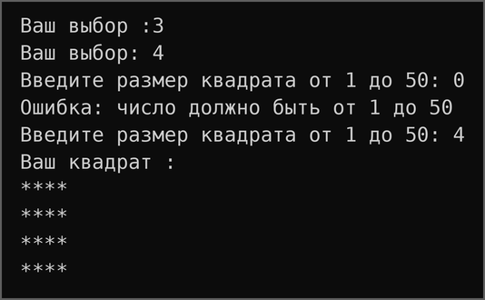

*Рисунок 14 – Задание 3, задача 7: работа программы*

## Задача 9

### Текст задачи

Реализовать функцию void rightTriangle(int x), выводящую треугольник из «\*» высотой x, выровненный по правому краю.

Общее требование к заданию: решение оформить в виде функции; в функции main организовать вызов с дружественным интерфейсом; если исходные данные вводятся с клавиатуры, выполнить проверку ввода.

### Алгоритм решения

1\. Меню (функция Task3, пункт 5) запрашивает размер функцией ReadIntInRange в отрезке от 1 до 50.

2\. В строке с номером i (от 1 до size) сначала выводятся size - i пробелов, затем i звёздочек.

3\. Пробелы сдвигают звёздочки к правому краю.

**Листинг 15 – Функция RightTriangle**

```cpp
// Задача 9 Правый треугольник
void RightTriangle(int size) {
    for (int i = 1; i <= size; ++i) {
        for (int j = 0; j < size - i; ++j) {
            std::cout << ' ';
        }
        for (int j = 0; j < i; ++j) {
            std::cout << '*';
        }
        std::cout << '\n';
    }
}
```

### Тестирование

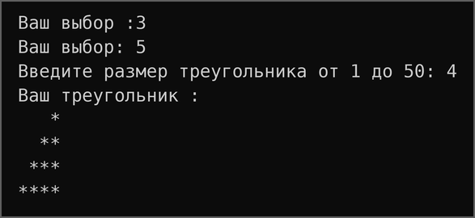

*Рисунок 15 – Задание 3, задача 9: работа программы*

*Таблица 3 – Результаты автотестов, задание 3*

<table>
<thead>
<tr class="header">
<th><strong>Входные данные</strong></th>
<th><strong>Ожидается</strong></th>
<th><strong>Получено</strong></th>
<th><strong>Итог</strong></th>
</tr>
</thead>
<tbody>
<tr class="odd">
<td>ListNums(5)</td>
<td>0 1 2 3 4 5</td>
<td>0 1 2 3 4 5</td>
<td>пройден</td>
</tr>
<tr class="even">
<td>ListNums(0)</td>
<td>0</td>
<td>0</td>
<td>пройден</td>
</tr>
<tr class="odd">
<td>ListNums(-1)</td>
<td>пустая строка</td>
<td>пустая строка</td>
<td>пройден</td>
</tr>
<tr class="even">
<td>Chet(9)</td>
<td>0 2 4 6 8</td>
<td>0 2 4 6 8</td>
<td>пройден</td>
</tr>
<tr class="odd">
<td>Chet(10)</td>
<td>0 2 4 6 8 10</td>
<td>0 2 4 6 8 10</td>
<td>пройден</td>
</tr>
<tr class="even">
<td>NumLen(12567)</td>
<td>5</td>
<td>5</td>
<td>пройден</td>
</tr>
<tr class="odd">
<td>NumLen(0)</td>
<td>1</td>
<td>1</td>
<td>пройден</td>
</tr>
<tr class="even">
<td>NumLen(-305)</td>
<td>3</td>
<td>3</td>
<td>пройден</td>
</tr>
<tr class="odd">
<td>Square(2)</td>
<td><p>**</p>
<p>**</p></td>
<td><p>**</p>
<p>**</p></td>
<td>пройден</td>
</tr>
<tr class="even">
<td>Square(4)</td>
<td><p>****</p>
<p>****</p>
<p>****</p>
<p>****</p></td>
<td><p>****</p>
<p>****</p>
<p>****</p>
<p>****</p></td>
<td>пройден</td>
</tr>
<tr class="odd">
<td>RightTriangle(3)</td>
<td><p>*</p>
<p>**</p>
<p>***</p></td>
<td><p>*</p>
<p>**</p>
<p>***</p></td>
<td>пройден</td>
</tr>
<tr class="even">
<td>RightTriangle(4)</td>
<td><p>*</p>
<p>**</p>
<p>***</p>
<p>****</p></td>
<td><p>*</p>
<p>**</p>
<p>***</p>
<p>****</p></td>
<td>пройден</td>
</tr>
</tbody>
</table>

# Задание 4

## Задача 1

### Текст задачи

Реализовать функцию int findFirst(int arr\[\], int x), возвращающую индекс первого вхождения x в массив или −1.

Общее требование к заданию: решение оформить в виде функции; в функции main организовать вызов с дружественным интерфейсом; если исходные данные вводятся с клавиатуры, выполнить проверку ввода.

### Алгоритм решения

1\. Меню (функция Task4, пункт 1) запрашивает размер массива функцией ReadIntInRange (от 1 до kMaxSize = 100), вводит элементы функцией ReadArr и искомое число.

2\. Выполняется линейный поиск: массив просматривается с начала, и при первом совпадении функция сразу возвращает индекс.

3\. Если цикл закончился без совпадений, возвращается −1, а меню выводит «Числа нет в массиве».

**Листинг 16 – Функция FindFirst**

```cpp
// Задача 1 Поиск первого значения
int FindFirst(const int* arr, int number, int limit) {
    for (int i = 0; i < limit; ++i) {
        if (arr[i] == number) {
            return i;
        }
    }
    return -1;
}
```

### Тестирование

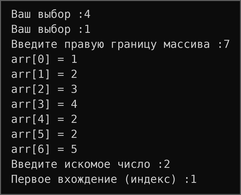

*Рисунок 16 – Задание 4, задача 1: работа программы*

## Задача 3

### Текст задачи

Реализовать функцию int maxAbs(int arr\[\]), возвращающую наибольшее по модулю значение массива (для \[1, −2, −7, 4, 2, 2, 5\] – −7).

Общее требование к заданию: решение оформить в виде функции; в функции main организовать вызов с дружественным интерфейсом; если исходные данные вводятся с клавиатуры, выполнить проверку ввода.

### Алгоритм решения

1\. Меню (функция Task4, пункт 2) запрашивает размер массива и вводит его элементы функцией ReadArr.

2\. Начальное значение результата – 0.

3\. Элементы сравниваются по модулю с помощью функции AbsNum из задания 2. При большем модуле результат заменяется самим элементом со своим знаком.

**Листинг 17 – Функция MaxAbs**

```cpp
// Задача 3 Поиск максимального по модулю
int MaxAbs(const int* arr, int limit) {
    int result = 0;
    for (int i = 0; i < limit; ++i) {
        if (AbsNum(arr[i]) > AbsNum(result)) {
            result = arr[i];
        }
    }
    return result;
}
```

### Тестирование

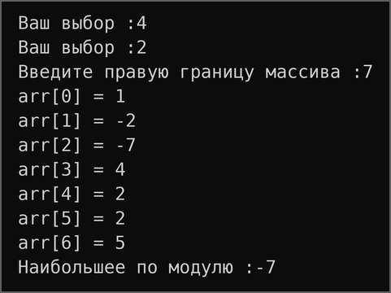

*Рисунок 17 – Задание 4, задача 3: работа программы*

## Задача 5

### Текст задачи

Реализовать функцию int\* add(int arr\[\], int ins\[\], int pos), возвращающую новый массив, в котором в позицию pos вставлены элементы ins.

Общее требование к заданию: решение оформить в виде функции; в функции main организовать вызов с дружественным интерфейсом; если исходные данные вводятся с клавиатуры, выполнить проверку ввода.

### Алгоритм решения

1\. Меню (функция Task4, пункт 3) вводит массив arr, массив ins и позицию вставки pos из отрезка \[0; размер arr\].

2\. Функция проверяет параметры: при отрицательных размерах или позиции вне отрезка \[0; limit\_one\] возвращается nullptr.

3\. Выделяется массив длины limit\_one + limit\_two, и тремя циклами в него копируются начало arr (до позиции pos), весь ins и остаток arr. Позицию записи задаёт счётчик limit\_result.

4\. Память, выделенную через new\[\], освобождает вызывающий код: меню вызывает delete\[\].

**Листинг 18 – Функция Add**

```cpp
// Задача 5 Добавление массива в массив
int* Add(const int* arr, const int* ins, int pos, int limit_one,
         int limit_two) {
    if (pos < 0 || pos > limit_one || limit_one < 0 || limit_two < 0) {
        return nullptr;
    }
    int* result = new int[limit_one + limit_two];
    int limit_result = 0;
    for (int i = 0; i < pos; ++i) {
        result[limit_result] = arr[i];
        ++limit_result;
    }
    for (int i = 0; i < limit_two; ++i) {
        result[limit_result] = ins[i];
        ++limit_result;
    }
    for (int i = pos; i < limit_one; ++i) {
        result[limit_result] = arr[i];
        ++limit_result;
    }
    return result;
}
```

### Тестирование

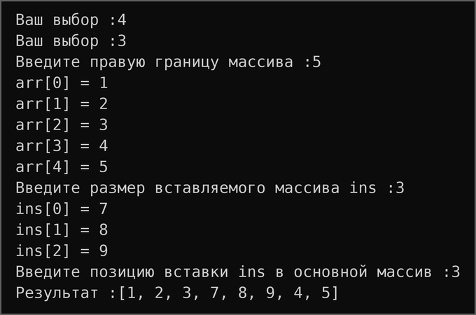

*Рисунок 18 – Задание 4, задача 5: работа программы*

## Задача 7

### Текст задачи

Реализовать функцию int\* reverseBack(int arr\[\]), возвращающую новый массив, в котором элементы arr записаны задом наперёд.

Общее требование к заданию: решение оформить в виде функции; в функции main организовать вызов с дружественным интерфейсом; если исходные данные вводятся с клавиатуры, выполнить проверку ввода.

### Алгоритм решения

1\. Меню (функция Task4, пункт 4) запрашивает размер массива и вводит его элементы.

2\. Выделяется новый массив такой же длины.

3\. Цикл проходит исходный массив с конца, а счётчик limit\_result задаёт позицию в новом массиве. Исходный массив не изменяется, так как передаётся как const int\*.

4\. Память из new\[\] освобождает вызывающий код.

**Листинг 19 – Функция ReverseBack**

```cpp
// Задача 7 Возвратный реверс
int* ReverseBack(const int* arr, int limit) {
    int* result = new int[limit];
    int limit_result = 0;
    for (int i = limit - 1; i >= 0; --i) {
        result[limit_result] = arr[i];
        ++limit_result;
    }
    return result;
}
```

### Тестирование

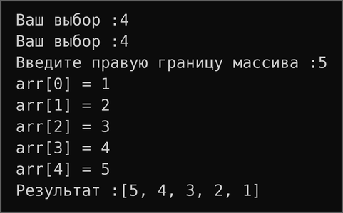

*Рисунок 19 – Задание 4, задача 7: работа программы*

## Задача 9

### Текст задачи

Реализовать функцию int\* findAll(int arr\[\], int x), возвращающую новый массив индексов всех вхождений x в arr.

Общее требование к заданию: решение оформить в виде функции; в функции main организовать вызов с дружественным интерфейсом; если исходные данные вводятся с клавиатуры, выполнить проверку ввода.

### Алгоритм решения

1\. Меню (функция Task4, пункт 5) вводит массив и искомое число.

2\. Задача решается в два прохода. Первый проход считает число вхождений, чтобы выделить массив нужного размера. Количество возвращается через параметр-указатель count\_limit, который стоит после входных параметров.

3\. Второй проход записывает в массив индексы найденных элементов.

4\. Если вхождений нет, меню выводит «Число не найдено в массиве»; память освобождается через delete\[\].

**Листинг 20 – Функция FindAll**

```cpp
// Задача 9 Все вхождения
int* FindAll(const int* arr, int number, int limit, int* count_limit) {
    *count_limit = 0;
    for (int i = 0; i < limit; ++i) {
        if (arr[i] == number) {
            ++*count_limit;
        }
    }
    int* result = new int[*count_limit];
    int limit_result = 0;
    for (int i = 0; i < limit; ++i) {
        if (arr[i] == number) {
            result[limit_result] = i;
            ++limit_result;
        }
    }
    return result;
}
```

### Тестирование

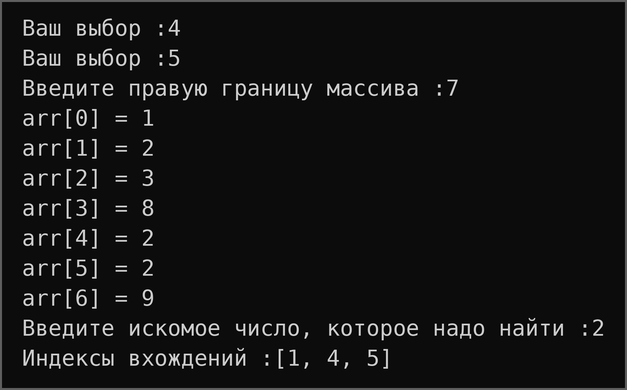

*Рисунок 20 – Задание 4, задача 9: работа программы*

*Таблица 4 – Результаты автотестов, задание 4*

| **Входные данные**                | **Ожидается**       | **Получено**        | **Итог** |
| --------------------------------- | ------------------- | ------------------- | -------- |
| FindFirst(\[1,2,3,4,2,2,5\],2)    | 1                   | 1                   | пройден  |
| FindFirst(\[1,2,3,4,2,2,5\],7)    | \-1                 | \-1                 | пройден  |
| MaxAbs(\[1,-2,-7,4,2,2,5\])       | \-7                 | \-7                 | пройден  |
| Add(\[1,2,3,4,5\],\[7,8,9\],3)    | \[1,2,3,7,8,9,4,5\] | \[1,2,3,7,8,9,4,5\] | пройден  |
| Add(\[1,2,3,4,5\],\[7,8,9\],0)    | \[7,8,9,1,2,3,4,5\] | \[7,8,9,1,2,3,4,5\] | пройден  |
| Add(..., pos=9) (pos вне массива) | nullptr             | nullptr             | пройден  |
| ReverseBack(\[1,2,3,4,5\])        | \[5,4,3,2,1\]       | \[5,4,3,2,1\]       | пройден  |
| FindAll(\[1,2,3,8,2,2,9\],2)      | \[1,4,5\]           | \[1,4,5\]           | пройден  |
| FindAll(\[1,2,3,8,2,2,9\],6)      | \[\]                | \[\]                | пройден  |
